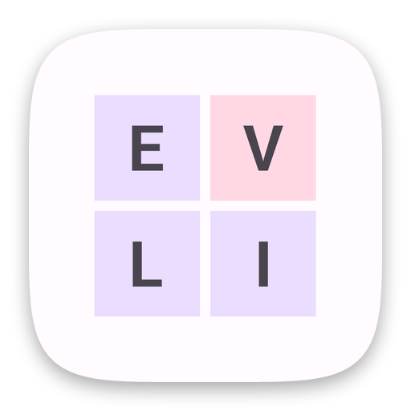

  

<h1 align="center">Palindrome</h1>

A word puzzle game. Put the letters back in place to rebuild a palindrome, a phrase that reads the same both ways. 
Game of the Week on Google Play Games in 2022 and 2023.

  
  &nbsp;
  

Android: Kotlin · Room · Hilt · Play Billing · Firebase 
iOS: Swift · UIKit · SpriteKit · Core Data · StoreKit · Firebase

## About the code

These are two separate native apps, `android/` in Kotlin and `ios/` in Swift, each with its own history. Most of the code is my own work from 2021 to 2023. Changes in 2026, such as the Stagenator push integration, were made with AI coding agents.

Level packs, pictures and sounds are not included.

© 2021–2026 Indest OÜ. All rights reserved.

The Roboto font uses the Apache License 2.0 ([third_party/roboto/LICENSE](third_party/roboto/LICENSE)). The other fonts use the SIL Open Font License.
